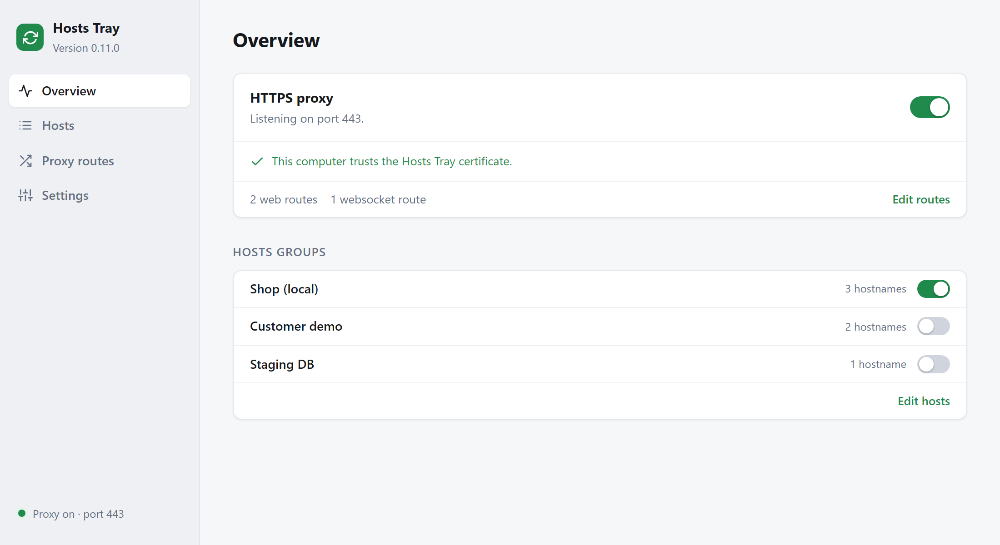
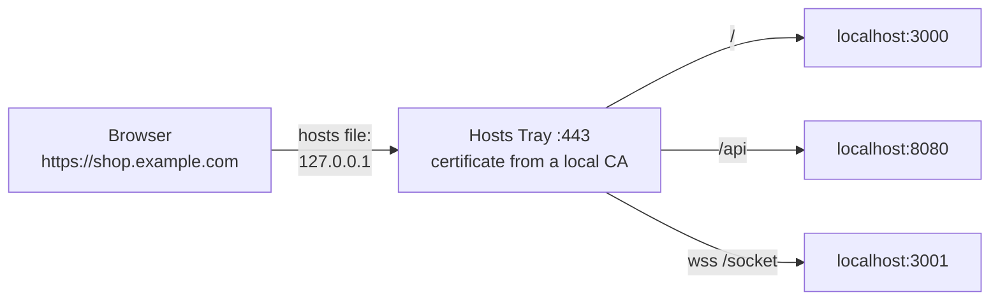
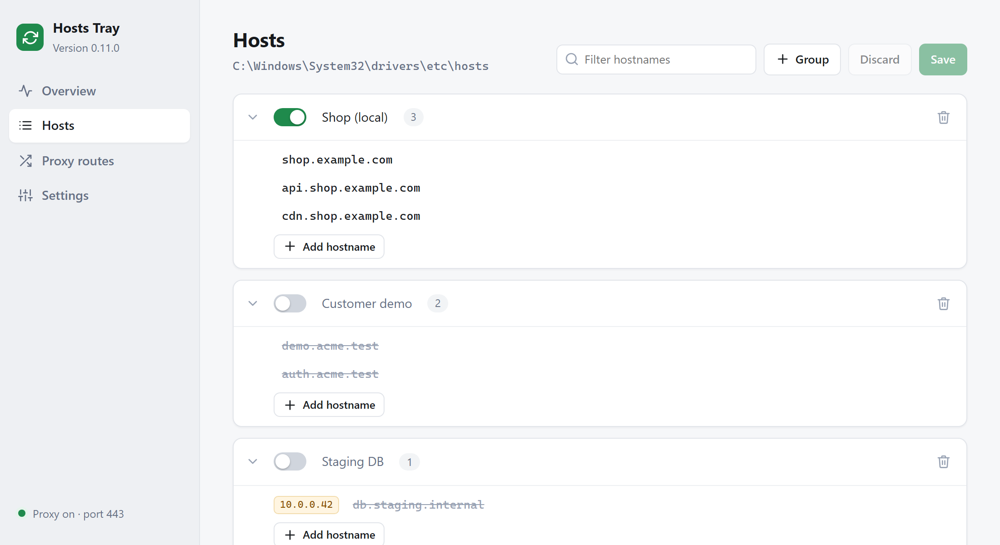
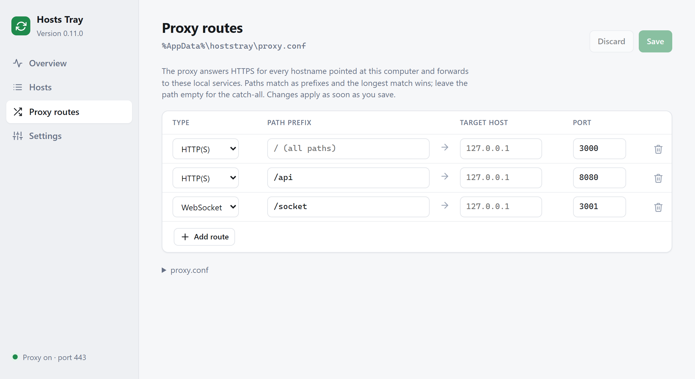

<p align="center">
  
</p>

<h1 align="center">Hosts Tray</h1>

<p align="center">
  <b>Real domains, local servers, valid HTTPS. From your menu bar.</b><br>
  Toggle groups of hosts file entries and run a local HTTPS proxy with<br>
  auto-generated certificates, so <code>https://app.example.com</code> hits your dev server on <code>localhost:3000</code>.
</p>

<p align="center">
  <a href="https://github.com/maxmart/hoststray/releases/latest"></a>
  
  <a href="LICENSE"></a>
</p>

<p align="center">
  <a href="https://github.com/maxmart/hoststray/releases/latest"><b>Download for macOS</b></a> ·
  <a href="https://github.com/maxmart/hoststray/releases/latest"><b>Download for Windows</b></a>
</p>

<p align="center">
  <picture>
    <source media="(prefers-color-scheme: dark)" srcset="docs/screenshots/overview-dark.png">
    
  </picture>
</p>

<!-- TODO: tray menu GIF (tick a group, open https://shop.example.com, green padlock) -->

## Why

Cookies, CORS, OAuth callbacks and service workers often only behave on the
real hostname over HTTPS. Getting there by hand means editing an admin-owned
hosts file, generating and trusting certificates, and running a reverse proxy.
Hosts Tray does all three from a tray icon: one native binary, under 9 MB on
macOS, no config files to write.

## Quick start

1. **Install** the [latest release](https://github.com/maxmart/hoststray/releases/latest):
   the `.pkg` on macOS, `Hosts-Tray-<version>-windows-amd64-setup.exe` on Windows.
2. **Add a group** in **Open Hosts Tray… → Hosts**, or straight in your hosts file:
   ```
   #==== Shop
   127.0.0.1  shop.example.com
   #====
   ```
3. **Turn on the proxy** from the tray menu and trust the certificate when asked.
   `https://shop.example.com` now reaches `localhost:80`; change the target
   under **Proxy routes**.

## How it works



The hosts file points the name at your machine, the proxy answers with a
certificate for that name signed by a CA your computer trusts, and the route
table decides which local port gets the request.

## Features

- 🗂️ **Hosts groups.** Sections of your hosts file, switched on and off from the tray menu.
- 🔒 **HTTPS proxy.** A certificate per hostname on the fly, websockets included.
- 🧭 **Routes.** Send paths and websocket upgrades to different ports; changes apply on save.
- 🖥️ **Console.** One local web page for the proxy, groups, routes and settings.
- 🔑 **No password prompts, if you want.** One opt-in setting and toggles stop asking.
- 📦 **Move to another computer.** Export and import groups and routes as one text file.
- 🤖 **Agent skill.** Claude Code and other coding agents can switch groups and the proxy.
- 🔄 **Auto-update** from GitHub Releases, checksum-verified.

<p align="center">
  <picture>
    <source media="(prefers-color-scheme: dark)" srcset="docs/screenshots/hosts-dark.png">
    
  </picture>
  <picture>
    <source media="(prefers-color-scheme: dark)" srcset="docs/screenshots/routes-dark.png">
    
  </picture>
</p>

## Compared to

| | SwitchHosts | mkcert | Caddy by hand | **Hosts Tray** |
| --- | :---: | :---: | :---: | :---: |
| Toggle hosts groups from a menu | ✅ | | | ✅ |
| Trusted HTTPS certificates | | ✅ one command per name | ✅ `tls internal` | ✅ automatic per name |
| Reverse proxy and websockets | | | ✅ | ✅ |
| No config file to write | ✅ | ✅ | | ✅ |
| Coding agents can drive it | | | | ✅ |

## Install

Download from the [latest release](https://github.com/maxmart/hoststray/releases/latest):

- **macOS**: `Hosts-Tray-<version>.pkg` installs to Applications. The
  `-mac.zip` contains the same app if you'd rather drag it there yourself.
- **Windows**: `Hosts-Tray-<version>-windows-amd64-setup.exe` (or `arm64`)
  installs for your user into `%LOCALAPPDATA%\Programs\Hosts Tray`, without
  admin rights, with a Start menu entry and an uninstaller. The bare
  `hoststray-<version>-windows-amd64.exe` also runs from anywhere.

The app lives in the menu bar (macOS) or the notification area (Windows);
there's no window or Dock icon.

Uninstalling on Windows asks whether to also remove settings and
certificates; yes also stops Windows trusting the Hosts Tray CA and removes
password-free hosts access. Hosts file entries are always kept.

## Hosts file groups

Groups are delimited by `#====` markers. An opening marker carries the name,
an empty one closes the group. Everything else in the file is left untouched.

```
#==== Staging
127.0.0.1  app.example.com
127.0.0.1  api.example.com
#====

#==== Customer demo
#127.0.0.1  demo.example.com
#====
```

Each group appears as a checkbox in the tray menu. Unchecking comments out
every entry in the group; checking uncomments them. A group counts as enabled
only when all of its entries are. Only IPv4 entries are managed; comments,
blank lines and anything else are preserved byte for byte.

**Open Hosts Tray…** in the tray menu opens the console in your browser;
**Edit hosts…** and **Edit proxy routes…** open it at those sections. It's
served by the app on `127.0.0.1` and only works through the links from the
tray menu.

### Passwords

The hosts file belongs to the system, so changing it needs admin rights. By
default every change asks for your password (macOS) or a UAC confirmation
(Windows). **Settings → Change hosts without password** instead gives your
user account write access to the hosts file once, so later toggles, including
ones from agents, don't prompt. The app offers this after the first prompted
change. The trade-off: other programs running as you could then edit the
hosts file too.

## HTTPS proxy

Turn on **HTTPS proxy on :443** in the tray menu. The icon turns green while
the proxy runs, and it stays on across restarts until you turn it off.

On first start the app creates a root CA and offers to trust it for your user
account (macOS asks for your password; Windows asks you to confirm). Each
hostname that connects gets its own certificate signed by that CA, so any name
you point at `127.0.0.1` in the hosts file works immediately.

Forwarded requests carry `X-Forwarded-Proto: https`, `X-Forwarded-Port`,
`X-Forwarded-Host` and `X-Forwarded-For`, so your backend can build correct
absolute URLs.

### Routes

Routes live in `proxy.conf` in the app's data folder and are edited in the
console (**Edit proxy routes…** in the tray menu). One rule per line:

```
# <pattern> -> <target>
* -> :80                       # all HTTPS traffic to 127.0.0.1:80
wss://*/socket -> :5124        # websocket upgrades under /socket to :5124
https://*/api -> 10.0.0.5:8080 # a path prefix to another host
```

- A target of `:PORT` means `127.0.0.1:PORT`. `host:PORT` picks a specific host.
- Patterns starting with `ws://` or `wss://` match websocket upgrades only.
  Upgrades that match no websocket route use the web routes.
- When several routes match, the longest path prefix wins. `*` is the catch-all.

## Moving to another computer

In the console, **Settings > Export** copies or downloads your hosts groups and
proxy routes as one text file. The rest of the hosts file is machine-specific
and stays behind, and so does the certificate authority: the other computer
makes its own and trusts it once.

```
[hosts]
#==== DEV
127.0.0.1  app.example.com
#====
[routes]
* -> :3000
```

**Settings > Import** takes the file or pasted text and shows what will change
before anything does. Groups merge by name: the same name replaces, new names
are added, and groups not in the file are left alone. Routes, when the file has
them, replace the current ones. The hosts file is written once, so at most one
password prompt. Agents can't import.

## Agents

> [!TIP]
> **Settings → Install agent skill** in the tray menu, then ask Claude Code
> something like *"turn on the Shop hosts group and the proxy"*.

Coding agents drive Hosts Tray over its local HTTP API, guided by a skill
file. The menu item writes it to `~/.claude/skills/hoststray/SKILL.md`. Other
agents can read the same file from `http://127.0.0.1:47443/SKILL.md`. No MCP
or other setup is needed.

The skill tells the agent to read a token from `token` in the data folder and
call these endpoints with it:

| Endpoint | What it does |
| --- | --- |
| `GET /api/status` | Groups with their entries, proxy state, port, CA trust, routes |
| `POST /api/group` `{"name","enabled"}` | Switch an existing group on or off |
| `POST /api/proxy/enabled` `{"enabled"}` | Start or stop the proxy |

The agent token is new on each launch and only works for those three. The
console uses a separate token that never touches disk, so agents can't add
hostnames, groups or routes, or trust the CA. Pointing a real domain at
localhost behind a trusted CA lets whoever controls it intercept that site's
traffic, so those stay with you in the console. The server only answers on
`127.0.0.1` and rejects requests from web pages, so websites can't reach it.

## Updates

The app checks the latest GitHub release at launch and every six hours. When
there's a newer version it downloads it, checks it against the release's
`SHA256SUMS`, and on macOS also checks that it's signed by the same Apple team
as the running app. Then it offers to restart. An app installed by the `.pkg`
is owned by root, so installing the update asks for your password.
**Settings → Check for updates** checks right away.

## Data and logs

Settings, `proxy.conf`, the CA (`_certs/`) and `hoststray.log` live in
`~/Library/Application Support/hoststray` (macOS) or `%AppData%\hoststray`
(Windows). **Settings → Show data folder** opens it.

<details>
<summary><b>Environment variables</b></summary>

| Variable | Default | Purpose |
| --- | --- | --- |
| `PORT` | `443` | Proxy port |
| `LISTEN_HOST` | all interfaces | Proxy listen address, e.g. `127.0.0.1` |
| `FORWARD_HOST` | `127.0.0.1` | Default target host for routes without one |
| `PROXY_TIMEOUT` | `300` | Upstream response timeout in seconds |
| `HOSTS_PATH` | system hosts file | Work on a copy instead; opens the console at launch |
| `OPEN_PROXY_EDITOR` | unset | Open the console at proxy routes at launch |
| `HOSTSTRAY_ADMIN_PORT` | `47443` | Port for the console and API |
| `HOSTSTRAY_DATA_DIR` | see above | Data folder |
| `HOSTSTRAY_UPDATE_URL` | GitHub latest release | Release feed, for testing updates |

`--headless` runs without a tray icon (console, API and proxy still work).

</details>

<details>
<summary><b>Development</b></summary>

Needs Go 1.27 or newer; on macOS, Xcode command line tools (the tray uses cgo).

```sh
go run .                         # run from source
go test ./...                    # unit and integration tests
```

To try things without touching the real hosts file, copy it somewhere and run
with `HOSTS_PATH` pointing at the copy.

The hosts and `proxy.conf` parsers were ported from the original JavaScript
version; `internal/*/testdata/js_golden.json` holds that version's output for 800 inputs
each, and the tests check the Go port produces exactly the same.

Two opt-in macOS test suites need someone at the screen:

- `HOSTSTRAY_UI_TESTS=1 go test ./internal/platform/` clicks real dialogs.
- `HOSTSTRAY_ADMIN_TESTS=1 go test -run Admin ./internal/platform/` runs the
  password prompts (elevated write, password-free on/off, CA trust) against a
  throwaway file and CA. You type your password five times.

</details>

<details>
<summary><b>Releasing</b></summary>

```sh
VERSION=0.11.0 ./scripts/build-release.sh   # build everything into dist/
VERSION=0.11.0 ./scripts/release.sh         # publish dist/ as a GitHub release (gh CLI)
```

`build-release.sh` produces `Hosts-Tray-<v>-mac.zip` and `.pkg` (universal,
signed and notarized, via `scripts/build-mac.sh`),
`hoststray-<v>-windows-{amd64,arm64}.exe` with icon and manifest, their
installers `Hosts-Tray-<v>-windows-{amd64,arm64}-setup.exe` (needs
`brew install makensis`; skipped without it, see `scripts/windows/installer.nsi`),
and the `SHA256SUMS` the updater requires.

macOS signing needs, in your keychain, a **Developer ID Application**
certificate (and **Developer ID Installer** for the `.pkg`), plus an
app-specific password for notarization. Copy `.env.example` to `.env` and fill
it in. Without it, `build-mac.sh` builds an ad-hoc signed app for local use;
`NOTARIZE=0` signs without notarizing, for quick test builds.

The Windows executables and installers are not code-signed yet, so
SmartScreen warns on first run.

</details>

## License

[MIT](LICENSE)
