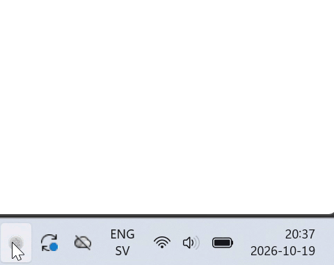
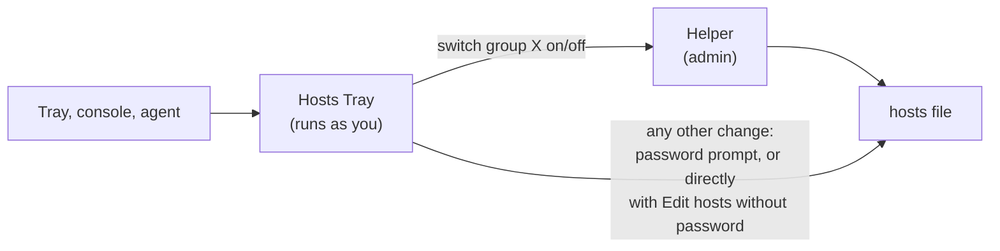

<p align="center">
  
</p>

<h1 align="center">Hosts Tray</h1>

<p align="center">
  <b>Real hostnames with trusted HTTPS on your local dev server, switched from your tray.</b><br>
  Point <code>app.example.com</code> at <code>localhost:3000</code> and test cookies, OAuth callbacks and CORS exactly as in production.<br>
  No certs to generate, no proxy config, no browser warnings.
</p>

<p align="center">
  <a href="https://github.com/maxmart/hoststray/releases/latest"></a>
</p>

<p align="center">
  <a href="https://github.com/maxmart/hoststray/releases/latest"><b>Download for macOS</b></a> ·
  <a href="https://github.com/maxmart/hoststray/releases/latest"><b>Download for Windows</b></a>
</p>

<p align="center">
  
</p>

## Why Hosts Tray

- 🔒 **Trusted HTTPS for every hostname, automatically.** A local CA your machine
  trusts issues a certificate the first time each name is requested. Websockets included.
- 🔁 **Browsers actually follow the switch.** Browsers keep pooled connections to the
  old address, so hosts edits often don't take effect for minutes. Hosts Tray flushes
  DNS and drops those connections on every change.
- 🗂️ **Hosts groups in one click.** Mark sections of your hosts file and switch each
  on or off from the tray menu.
- 🤖 **Coding agents can drive it.** Claude Code and others switch groups and the proxy
  through a [local API](#agents). Adding hostnames always needs your click.

Also: path and websocket [routes](#routes), opt-in [password-free switching](#passwords),
a local web console, [export/import](#moving-to-another-computer), and checksum-verified
auto-updates. One ~10 MB native Go app, no config files to write.

## Quick start

1. **Install** the [latest release](https://github.com/maxmart/hoststray/releases/latest):
   the `.pkg` on macOS, `Hosts-Tray-<version>-windows-amd64-setup.exe` on Windows.
2. **Add a group** in **Open Hosts Tray… → Hosts**, or straight in your hosts file:
   ```
   #==== Shop
   127.0.0.1  shop.example.com
   #====
   ```
3. **Turn on the proxy** from the tray menu and trust the certificate when asked.
   `https://shop.example.com` now reaches `localhost:80`; change the target
   under **Proxy routes**.

## How it works

<p align="center">
  <picture>
    <source media="(prefers-color-scheme: dark)" srcset="docs/screenshots/overview-dark.png">
    
  </picture>
</p>

<p align="center">
  <picture>
    <source media="(prefers-color-scheme: dark)" srcset="docs/screenshots/hosts-dark.png">
    
  </picture>
  <picture>
    <source media="(prefers-color-scheme: dark)" srcset="docs/screenshots/routes-dark.png">
    
  </picture>
</p>

## Compared to

| | SwitchHosts, Gas Mask | portless | mkcert + Caddy | whistle, Fiddler | **Hosts Tray** |
| --- | :---: | :---: | :---: | :---: | :---: |
| Your real hostnames, like `app.example.com` | ✅ | `app.localhost` style | ✅ | ✅ | ✅ |
| Trusted HTTPS certificates | | ✅ | ✅ one command per name | ✅ | ✅ automatic per name |
| Browsers switch right away | | | | ✅ | ✅ |
| Switch hosts groups from a menu | ✅ | | | | ✅ |
| Reverse proxy and websockets | | ✅ | ✅ | ✅ | ✅ |
| Path routes to different ports | | | ✅ | ✅ | ✅ |
| No proxy settings in browser or system | ✅ | ✅ | ✅ | | ✅ |
| No config files or CLI | ✅ | | | ✅ | ✅ |
| Coding agents can drive it | | ✅ | | | ✅ |

SwitchHosts and Gas Mask (macOS) switch hosts files; PowerToys has a hosts
editor on Windows. portless gives each dev server a stable `.localhost` name
with HTTPS. whistle, Fiddler, Charles and Proxyman are debugging proxies: they
can remap hosts and decrypt HTTPS, but traffic has to be sent through them.

## Install

Download from the [latest release](https://github.com/maxmart/hoststray/releases/latest):

- **macOS**: `Hosts-Tray-<version>.pkg` installs to Applications. The
  `-mac.zip` contains the same app if you'd rather drag it there yourself.
- **Windows**: `Hosts-Tray-<version>-windows-amd64-setup.exe` (or `arm64`)
  installs for your user into `%LOCALAPPDATA%\Programs\Hosts Tray`, without
  admin rights, with a Start menu entry and an uninstaller. The bare
  `hoststray-<version>-windows-amd64.exe` also runs from anywhere. The Windows
  builds aren't code-signed yet, so SmartScreen asks once: *More info → Run anyway*.

The app lives in the menu bar (macOS) or the notification area (Windows);
there's no window or Dock icon.

Uninstalling on Windows asks whether to also remove settings and
certificates; yes also stops Windows trusting the Hosts Tray CA and removes
password-free hosts editing. The password-free helper is always removed
(one UAC prompt, if it's installed). Hosts file entries are always kept.

## HTTPS proxy and certificates

Turn on **HTTPS proxy on :443** in the tray menu. The icon turns green while
the proxy runs, and it stays on across restarts until you turn it off.

On first start the app creates a root CA and offers to trust it for your user
account (macOS asks for your password; Windows asks you to confirm). Each
hostname that connects gets its own certificate signed by that CA, so any name
you point at `127.0.0.1` in the hosts file works immediately.

Another program can listen on `127.0.0.1:443` alongside the proxy and quietly
take its traffic. The app checks for that while the proxy runs and tells you
which program it is when it can tell.

Forwarded requests carry `X-Forwarded-Proto: https`, `X-Forwarded-Port`,
`X-Forwarded-Host` and `X-Forwarded-For`, so your backend can build correct
absolute URLs.

### Use the certificates in your own dev server

The certificates are plain PEM files in `_certs/` in the data folder, named
after the hostname: `local.example.com.crt` and `local.example.com.key`. Since
your computer already trusts the Hosts Tray CA, a dev server that serves HTTPS
itself can use them directly, for example Create React App on
`https://local.example.com:3000`, without going through the proxy.

In `package.json` on Windows:

```json
"start:https": "set HTTPS=true&&set SSL_CRT_FILE=%APPDATA%\\hoststray\\_certs\\local.example.com.crt&&set SSL_KEY_FILE=%APPDATA%\\hoststray\\_certs\\local.example.com.key&&react-scripts start"
```

And on macOS:

```json
"start:https": "HTTPS=true SSL_CRT_FILE=\"$HOME/Library/Application Support/hoststray/_certs/local.example.com.crt\" SSL_KEY_FILE=\"$HOME/Library/Application Support/hoststray/_certs/local.example.com.key\" react-scripts start"
```

A name's certificate is made the first time the proxy serves it, so open
`https://local.example.com` once with the proxy on. Certificates last a little
over two years and are renewed when the proxy serves the name in the last
month.

> [!TIP]
> Add a DNS record pointing `local.yourdomain.com` at `127.0.0.1`. Everyone on
> the team then gets a local name under your real domain, with its cookies,
> OAuth callbacks and CORS rules, without touching their hosts file, and
> Hosts Tray gives it a trusted certificate.

### Routes

Routes live in `proxy.conf` in the app's data folder and are edited in the
console (**Edit proxy routes…** in the tray menu). One rule per line:

```
# <pattern> -> <target>
* -> :80                       # all HTTPS traffic to 127.0.0.1:80
wss://*/socket -> :5124        # websocket upgrades under /socket to :5124
https://*/api -> 10.0.0.5:8080 # a path prefix to another host
```

- A target of `:PORT` means `127.0.0.1:PORT`. `host:PORT` picks a specific host.
- Patterns starting with `ws://` or `wss://` match websocket upgrades only.
  Upgrades that match no websocket route use the web routes.
- When several routes match, the longest path prefix wins. `*` is the catch-all.

## Moving to another computer

In the console, **Settings > Export** copies or downloads your hosts groups and
proxy routes as one text file. The rest of the hosts file is machine-specific
and stays behind, and so does the certificate authority: the other computer
makes its own and trusts it once.

```
[hosts]
#==== DEV
127.0.0.1  app.example.com
#====
[routes]
* -> :3000
```

**Settings > Import** takes the file or pasted text and shows what will change
before anything does. Groups merge by name: the same name replaces, new names
are added, and groups not in the file are left alone. Routes, when the file has
them, replace the current ones. The hosts file is written once, so at most one
password prompt. Agents can't import.

## Agents

> [!TIP]
> **Settings → Install agent skill** in the tray menu, then ask Claude Code
> something like *"turn on the Shop hosts group and the proxy"*.

Coding agents drive Hosts Tray over its local HTTP API, guided by a skill
file. The menu item writes it to `~/.claude/skills/hoststray/SKILL.md`. Other
agents can read the same file from `http://127.0.0.1:47443/SKILL.md`. No MCP
or other setup is needed.

The skill tells the agent to read a token from `token` in the data folder and
call these endpoints with it:

| Endpoint | What it does |
| --- | --- |
| `GET /api/status` | Groups with their entries, proxy state, port, CA trust, routes |
| `POST /api/group` `{"name","enabled"}` | Switch an existing group on or off |
| `POST /api/group/entries` `{"group","entries":[{"ip","host"}]}` | Ask to add hostnames to a group (created if needed) |
| `POST /api/proxy/enabled` `{"enabled"}` | Start or stop the proxy |

Adding hostnames shows you a dialog listing them, and nothing changes unless
you click **Add**. Everything else (removing or renaming, routes, import,
trusting the CA) stays with you in the console; see [Security](#security).

## Security

Hosts Tray changes a system file and runs a certificate authority your
computer trusts, so it's built to hand out as little power as possible.
Pointing a real domain at your machine behind a trusted CA would let whoever
did it read that site's traffic, so adding or changing where a name points
always needs you.

### Passwords

The hosts file belongs to the system, so changing it needs admin rights. By
default every change asks for your password (macOS) or a UAC confirmation
(Windows). The prompts come from the system and name Hosts Tray: the macOS
admin dialog with the Hosts Tray icon (macOS doesn't offer Touch ID for running
things as root), or a UAC prompt for `hoststray.exe` itself. The app runs as
admin only for that one step.

Two settings, in the tray menu's **Settings** and in the console, take the
prompts away:

- **Switch groups without password** installs a small helper: a launchd
  daemon on macOS, a service on Windows. Switching groups on or off, from the
  tray, the console or an agent, then goes through it without a prompt. The
  app offers this after the first prompted switch.
- **Edit hosts without password** gives your user account write access to the
  hosts file, so editing it in the console, importing and agent additions
  stop asking as well.

### The helper

Switching groups without a password needs something running as admin. The app
itself never does; a separate helper does that one job:



- **It can only switch existing groups on or off.** It understands two
  requests: its version, and "turn group X on or off". It reads the hosts file
  itself and comments or uncomments the lines inside that group. It never takes
  file content or new entries, so it can't point a name somewhere new.
- **Only your user account can reach it.** On macOS it listens on a socket in
  `/var/run` owned by your user and checks the caller's user ID on every
  connection. On Windows it's a named pipe whose permissions admit only your
  account, and connections from other machines are refused.
- **The app checks it's the real helper.** Before sending anything, the app
  verifies that the other end runs as root (macOS) or is the Hosts Tray helper
  service itself (Windows), so another program can't pose as it.
- **It stays small.** A few connections at a time, size-limited requests with
  timeouts, and the hosts file is replaced in one atomic step.
- **It cleans up after itself.** It serves one user and one app. If the app is
  deleted, the helper removes itself; the Windows uninstaller removes it
  straight away. After an app update, the app offers to update the helper and
  uses the password prompt until you do.

The trade-off: any program running as you can switch your existing groups
through the helper, just as it could click the tray menu.

**Edit hosts without password** goes further: it gives your account write
access to the hosts file, so any program running as you can edit it. Leave it
off unless you want no prompts at all.

### The local API and console

The API and console only answer on `127.0.0.1` and reject requests from web
pages, so websites can't reach them. The agent token is new on each launch and
only works for the four endpoints above. The console uses a separate token
that never touches disk, so agents can't remove or rename anything, change
routes, import, or trust the CA.

### The certificate authority

The CA is created on your computer, its private key stays in the data folder,
and it's trusted for your user account only. Each hostname gets its own
certificate from it. Uninstalling on Windows with *remove settings* removes
the trust.

## Updates

The app checks the latest GitHub release at launch and every six hours. When
there's a newer version it downloads it, checks it against the release's
`SHA256SUMS`, and on macOS also checks that it's signed by the same Apple team
as the running app. Then it offers to restart. An app installed by the `.pkg`
is owned by root, so installing the update asks for your password.
**Settings → Check for updates** checks right away.

## Data and logs

Settings, `proxy.conf`, the CA (`_certs/`) and `hoststray.log` live in
`~/Library/Application Support/hoststray` (macOS) or `%AppData%\hoststray`
(Windows). **Settings → Show data folder** opens it.

<details>
<summary><b>Environment variables</b></summary>

| Variable | Default | Purpose |
| --- | --- | --- |
| `PORT` | `443` | Proxy port |
| `LISTEN_HOST` | all interfaces | Proxy listen address, e.g. `127.0.0.1` |
| `FORWARD_HOST` | `127.0.0.1` | Default target host for routes without one |
| `PROXY_TIMEOUT` | `300` | Upstream response timeout in seconds |
| `HOSTS_PATH` | system hosts file | Work on a copy instead; opens the console at launch |
| `OPEN_PROXY_EDITOR` | unset | Open the console at proxy routes at launch |
| `HOSTSTRAY_ADMIN_PORT` | `47443` | Port for the console and API |
| `HOSTSTRAY_DATA_DIR` | see above | Data folder |
| `HOSTSTRAY_UPDATE_URL` | GitHub latest release | Release feed, for testing updates |

`--headless` runs without a tray icon (console, API and proxy still work).

</details>

Building from source or releasing: see [CONTRIBUTING.md](CONTRIBUTING.md).

## Credits
I started this project by adapting from [mlebkowski/nassau-https-proxy](https://github.com/mlebkowski/nassau-https-proxy) and writing an Electron wrapper around it. Since Electron bundles Chromium the binaries were huge and Claude rewrote all of it in Go. 

The idea for killing connections to force Chrome to refresh DNS was from [tinycedar/lily](https://github.com/tinycedar/lily). 

## License

[MIT](LICENSE)
